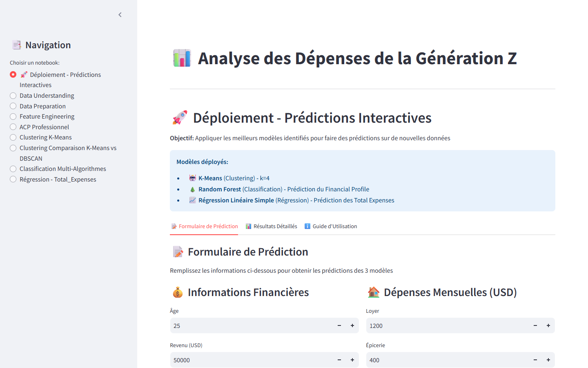
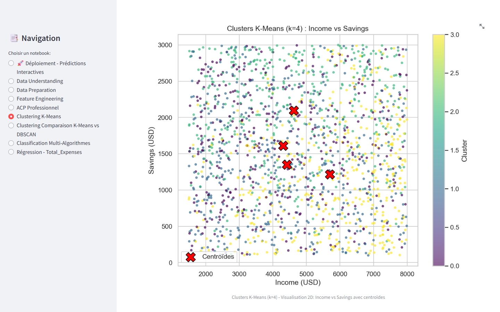
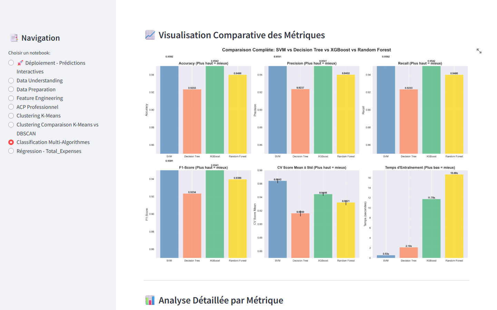
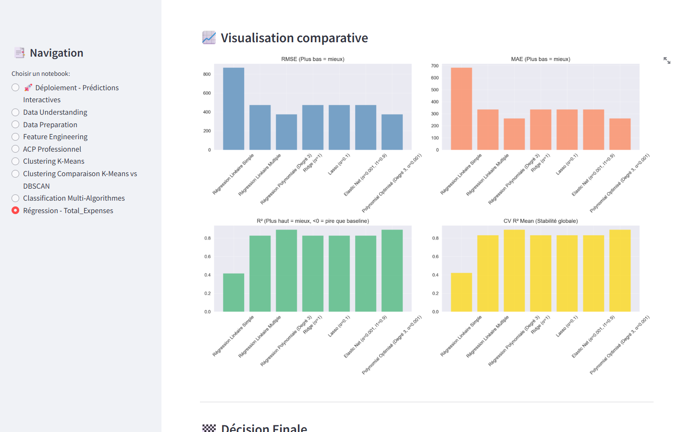
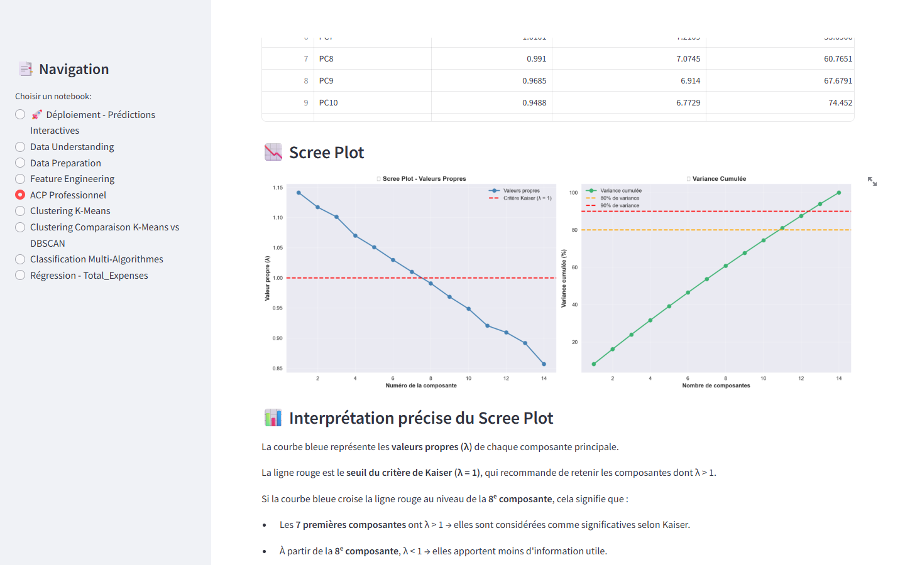

# Analyse des Dépenses de la Génération Z

[](https://github.com/jamoussiamine/genz-spending-analysis/actions/workflows/ci.yml)


[](LICENSE)

Projet de Machine Learning réalisé à ESPRIT (spécialité ERP-BI) : comprendre, segmenter et prédire les comportements financiers de la Génération Z à partir de leurs revenus, dépenses, épargne et investissements.

Le projet couvre toute la chaîne : préparation des données, feature engineering, ACP, clustering, classification et régression. Une application **Streamlit** présente chaque étape et permet de faire des prédictions interactives.

## Résultats

| Étape | Méthode retenue | Résultat |
|---|---|---|
| Clustering | K-Means (k = 4), comparé à DBSCAN | Silhouette 0,35 contre 0,18 pour DBSCAN |
| Classification du profil financier | SVM, comparé à Random Forest, XGBoost et arbre de décision | **Accuracy 95,9 %** (XGBoost 95,4 %, Random Forest 94,0 %) |
| Régression des dépenses totales | Régression polynomiale de degré 3 | **R² = 0,89** (linéaire multiple : 0,83) |
| ACP | 11 composantes pour 80 % de la variance | Variables peu corrélées : la réduction de dimension est limitée |

## Aperçu

| Prédiction interactive | Clustering K-Means (k = 4) |
|---|---|
|  |  |
| **Comparaison des modèles de classification** | **Comparaison des modèles de régression** |
|  |  |

<details>
<summary>ACP : valeurs propres et variance cumulée</summary>


</details>

## Démarrage rapide

> **Première installation ?** Le [guide d'installation](INSTALLATION.md) explique chaque étape en détail (Git, Docker ou Python, Windows / macOS / Linux) et les solutions aux problèmes fréquents.

### Option 1 : Docker (aucune installation Python)

```bash
docker compose up --build
```

Puis ouvrir http://localhost:8501. Pour arrêter : `docker compose down`.

Sans docker compose :

```bash
docker build -t genz-spending-analysis .
docker run --rm -p 8501:8501 genz-spending-analysis
```

Si le port 8501 est déjà utilisé, changer le port de gauche : `-p 8503:8501`, puis ouvrir http://localhost:8503.

### Option 2 : script automatique

Prérequis : **Python 3.10, 3.11 ou 3.12** ([python.org](https://www.python.org/downloads/)).

- **Windows** : double-cliquer sur `run.bat`
- **macOS / Linux** : `bash run.sh`

Au premier lancement, le script crée un environnement virtuel `.venv` et installe les dépendances. L'application s'ouvre ensuite sur http://localhost:8501 (ou 8502, 8503… si ce port est déjà pris : l'adresse exacte s'affiche dans le terminal).

### Option 3 : à la main

```bash
python -m venv .venv
# Windows : .venv\Scripts\activate    |    macOS / Linux : source .venv/bin/activate
pip install -r requirements.txt
streamlit run streamlit_app.py
```

## Notebooks

Les notebooks produisent les fichiers de `data/processed/` et `data/results/` que l'application affiche. Ils s'exécutent dans l'ordre :

| Notebook | Contenu | Données |
|---|---|---|
| `01_data_understanding_preparation` | Exploration, valeurs manquantes, outliers (IQR), normalisation | 6 000 individus |
| `02_feature_engineering` | Taux d'épargne, d'investissement et de dépenses, dépenses totales, indices de style de vie, profil financier | 6 000 individus |
| `03_pca` | ACP : valeurs propres, cercle des corrélations, choix du nombre de composantes | 1 700 individus |
| `04_kmeans_clustering` | K-Means, méthode du coude, silhouette, Calinski-Harabasz | 1 700 individus |
| `05_kmeans_vs_dbscan` | Comparaison K-Means et DBSCAN | 6 000 individus |
| `06_classification` | Arbre de décision, Random Forest, SVM, XGBoost | 6 000 individus |
| `07_regression` | Régressions linéaire, polynomiale et régularisées (Ridge, Lasso, Elastic Net) | 6 000 individus |

```bash
pip install -r requirements-notebooks.txt
jupyter notebook notebooks/
```

## Structure

```
├── streamlit_app.py            # Application Streamlit (9 pages)
├── utils_outliers.py           # Détection et traitement des outliers (IQR)
├── notebooks/                  # 01 à 07, dans l'ordre d'exécution
├── data/
│   ├── raw/                    # Jeux de données d'origine
│   ├── processed/              # Données préparées par les notebooks
│   └── results/                # Métriques (JSON / CSV) et graphiques
├── requirements.txt            # Dépendances de l'application (versions fixées)
├── requirements-notebooks.txt  # + Jupyter et XGBoost pour les notebooks
├── Dockerfile
├── docker-compose.yml
├── run.bat / run.sh            # Lancement en un clic
├── INSTALLATION.md            # Guide d'installation pas à pas
├── tests/                      # Tests automatiques des 9 pages (pytest)
├── docs/screenshots/           # Captures d'écran
├── .github/workflows/ci.yml    # Intégration continue : tests + image Docker
└── LICENSE
```

## Données

- `data/raw/dataset_genz_6000.csv` : 6 000 individus, 14 variables (âge, revenu, loyer, alimentation, sorties, loisirs, abonnements, éducation, achats en ligne, épargne, investissements, voyages, sport, divers), séparateur `;`
- `data/raw/genz_money_spends1.csv` : 1 700 individus, mêmes variables, utilisé pour l'ACP et le clustering K-Means

## Stack

Python · pandas · NumPy · SciPy · scikit-learn · XGBoost · Matplotlib · Seaborn · Streamlit · Docker

## Auteur

Med Amine Jamoussi, élève ingénieur ERP-BI à ESPRIT · [GitHub](https://github.com/jamoussiamine)

## Licence

[MIT](LICENSE)
